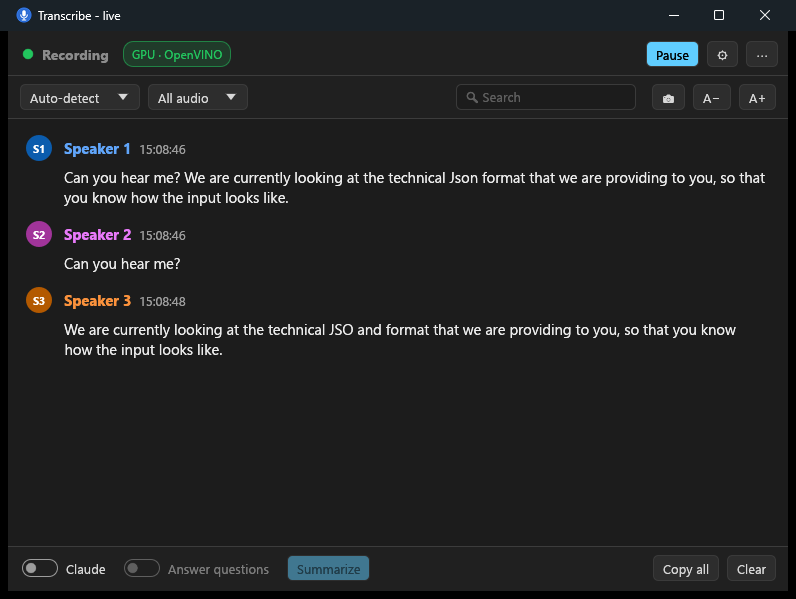
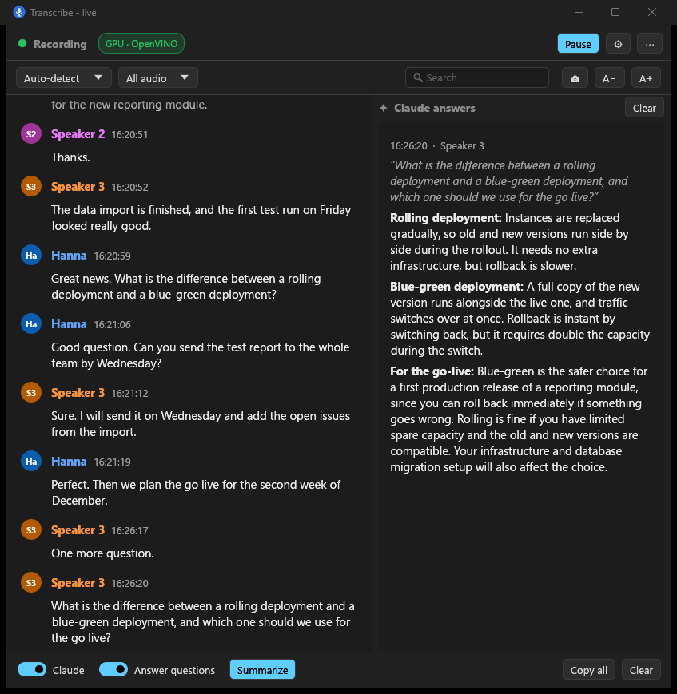
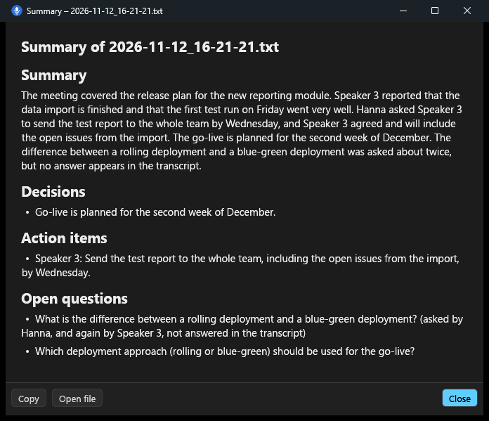
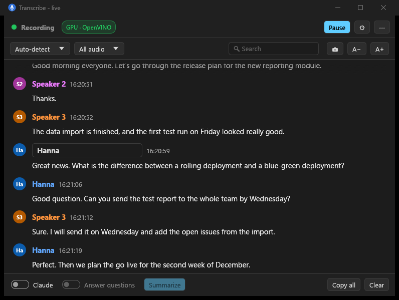
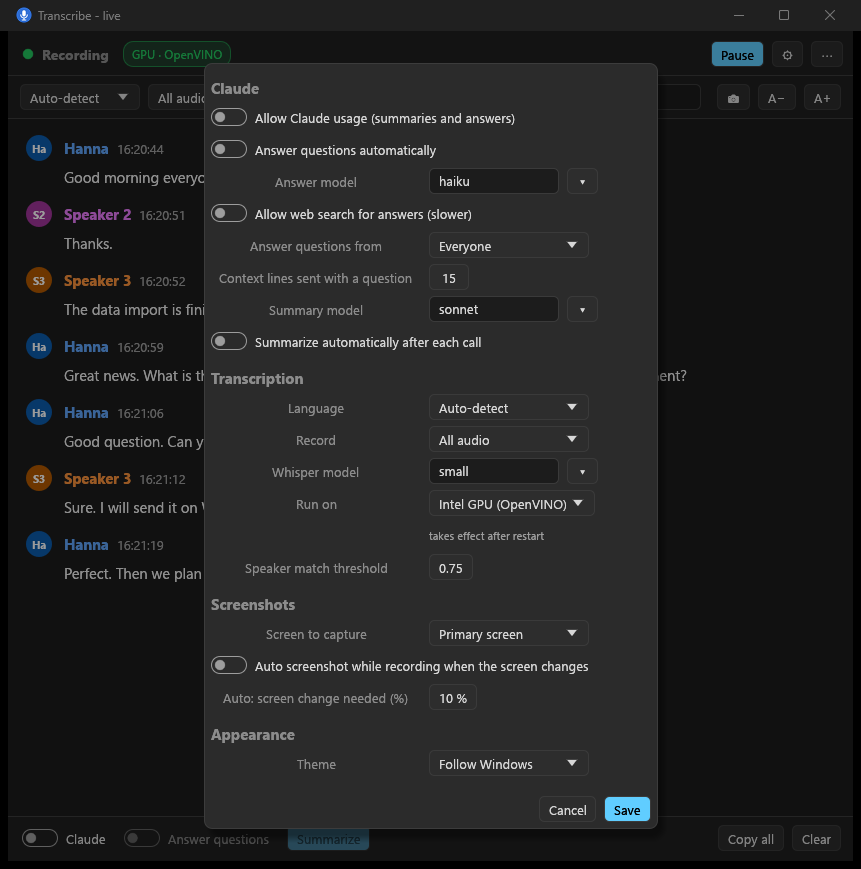

<p align="center">
  
</p>

<h1 align="center">Verba - Transcribe</h1>

<p align="center">
  Local, private call transcription for Windows: a tray app that writes down what you and the other side say,
  tells voices apart, and can summarize with Claude.
</p>

<p align="center">
  
</p>

Speech recognition runs on your own machine: nothing leaves the computer unless you switch Claude on.

**Contents:** [Features](#features) · [Screenshots](#screenshots) · [Quick start](#quick-start) · [Deploy](#deploy) ·
[Use](#use) · [Claude setup](#claude-setup) · [Speech recognition backends](#speech-recognition-backends) ·
[Build](#build) · [Privacy](#privacy) · [Code map](#code-map)

## Features

**Transcription**
- Records the **microphone** (you and the room) and the **speaker output** (Teams, Zoom, Meet, browser, anything
  playing) at the same time, with no meeting bot or plugin.
- **Whisper on the Intel GPU** via OpenVINO GenAI (about 1.3 s per 10 s of speech, with language auto-detection),
  with automatic **whisper.cpp CPU fallback**. A badge shows which engine is running, and why if it fell back.
- English by default; switch to automatic language detection or another language (German, French, Spanish,
  Italian, …) in the window.
- Filters Whisper's typical made-up text on silence (`[INAUDIBLE]`, "Thank you for watching", …) and the speaker
  echo picked up by the microphone.
- Optional grey live preview while someone is still speaking.

**Speakers**
- Tells voices apart (sherpa-onnx voiceprints): *Speaker 1*, *Speaker 2*, …
- **Click a name to rename it**: every earlier line and every later line of that voice uses the new name.
  Give two voices the same name to merge them.
- Named voices are remembered and recognized in later calls.

**Calls and files**
- **All audio** (default at start) or **Only calls**: recording starts when an app uses the microphone and stops
  when the call ends, with one transcript per call.
- **New transcript** button (and tray menu item) starts a fresh transcript at any time.
- Every transcript has its own folder with the transcript, its screenshots and its summary:
  `transcripts\2026-10-17_14-00-05_Teams\2026-10-17_14-00-05_Teams.txt`.
- Plain-text transcripts, `[14:03:12] [Hanna] Can you hear me?`.
- **Screenshots**: on demand (📷) or automatically when a chosen share of the screen changes; saved in the
  transcript's folder and referenced in the transcript.

**Claude (optional, off at every start)**
- **Summaries**: summary, decisions, action items and open questions, in the language of the call.
- **Live answers**: questions asked in the call are answered in a side panel (optionally with web search), or
  right-click any line → *Ask Claude about this*.
- Uses your installed Claude Code CLI ([setup](#claude-setup)); nothing is sent while the switch is off.

**App**
- System tray icon showing the state (recording, waiting for a call, paused, loading, error).
- Windows 11 look, light or dark following Windows, search, zoom, always on top.
- Follows default audio device changes and recovers dead microphone streams after sleep.
- Settings in the window (⚙) and in a commented `config.toml`.
- Deploys as one folder: `transcribe.exe` plus its libraries; models download on first start.

## Screenshots

All screenshots come from a test run with synthetic text-to-speech voices (`docs/make-demo-audio.ps1`); no real call
or person is shown.

<table>
  <tr>
    <td width="50%" valign="top">
      
      <p><b>Live answers.</b> A question asked in the call is answered by Claude in the side panel a few seconds later.</p>
    </td>
    <td width="50%" valign="top">
      
      <p><b>Summary.</b> Summary, decisions, action items and open questions, saved in the transcript's folder as Markdown.</p>
    </td>
  </tr>
  <tr>
    <td width="50%" valign="top">
      
      <p><b>Rename a speaker.</b> Click a name and type: every earlier and later line of that voice uses the new name.</p>
    </td>
    <td width="50%" valign="top">
      
      <p><b>Settings.</b> Claude, transcription, screenshots and appearance, saved to <code>config.toml</code>.</p>
    </td>
  </tr>
</table>

## Quick start

1. Build the package (see [Build](#build)) or take an existing `dist\transcribe\` folder.
2. Copy the folder anywhere and start `transcribe.exe`. The first start downloads the models.
3. Double-click the tray icon for the live window. Transcripts are written to `transcripts\` next to the exe, one folder
   per transcript. The first start shows the model download and loading progress next to the status.

Please make sure everyone you record agrees to it.

## Deploy

`dist\transcribe\` holds everything needed (built by `package.ps1`). Copy the folder anywhere and start `transcribe.exe`:

| File | What |
| --- | --- |
| `transcribe.exe` | the app; whisper.cpp and the C runtime are linked in |
| `sherpa-onnx-c-api.dll`, `onnxruntime.dll` | voice recognition (sherpa-onnx) |
| `openvino\` | GPU speech recognition (OpenVINO GenAI) and the VC++ runtime it needs; without it the app uses the CPU |

`config.toml`, `speakers.json`, `transcripts\` and `logs\` are created next to the exe. Models are downloaded on first start to `%LOCALAPPDATA%\transcribe-models`; an OpenVINO Whisper model already in the Hugging Face cache (`%USERPROFILE%\.cache\huggingface`) is used instead of downloading it again. Compiled GPU kernels are cached in `%LOCALAPPDATA%\transcribe-models\ov-cache`, so later starts are fast.

- `transcribe.exe --console` shows the log live (like `start-console.bat`).
- `transcribe.exe --transcribe file.wav` transcribes a 16 kHz mono WAV, to check an installation without a call.
- `transcribe.exe --feed a.wav b.wav …` pushes 16 kHz mono WAVs through the whole pipeline as speaker audio, back to
  back in time, to try the window, voices and Claude without a call.
- Autostart: Win+R, `shell:startup`, put a shortcut to `transcribe.exe` there.
- Only one instance runs at a time.

## Use

- Tray icon colours: orange loading, green recording, blue waiting for a call, grey paused, red error.
- **Live window** (double-click the tray icon). Closing it only hides it to the tray (a notification says the app is still running); quit with tray → **Quit**, or set `[ui] close_to_tray = false` so closing the window quits. Light/dark follows Windows (`[ui] theme`).
  - Next to the status: a badge showing what transcribes: green **GPU · OpenVINO**, or orange **CPU · whisper.cpp** (marked *fallback* when the GPU could not start; hover for the reason). The tray tooltip shows it too.
  - Top: status, Pause/Resume, ⚙ Settings, ⋯ (always on top, open transcript/folder, copy, clear).
  - Second row: language, record mode (only calls / all audio), search (Enter jumps to the next match), 📷 screenshot, A−/A+ (or Ctrl+mouse wheel).
  - Bottom: **Claude** switch, **Answer questions**, **Summarize**, **New transcript** (new file and folder, clears
    the window and the lines Claude sees as context), Copy all, Clear.
- **Record mode**: the app always starts with **All audio**. Choose **Only calls** (for this session) to record only while an app uses the microphone (until 10 s after it is free again); each call then gets its own file.
- **Speakers**: click a speaker name to edit it in place (Enter or clicking elsewhere saves, Esc cancels); give two voices the same name to merge them. Every earlier line (window, current transcript file, context sent to Claude) changes to the new name, and every later line of that voice uses it, also lines that were still being processed and later sessions. Named voices are stored in `speakers.json`. Keep that file to yourself.
- **Claude** (summaries and live answers through the Claude Code CLI, `claude -p`) is **always off when the app starts**. Switch it on in the window for the session; nothing is sent to Anthropic while it is off.
- **Screenshots**: 📷 in the window or *Take screenshot* in the tray. In ⚙ Settings choose the screen (primary, all, or a specific one) and turn on **auto screenshots**: while recording, the screen is checked every `check_seconds` and saved when at least `change_percent` % of it changed since the last screenshot. Screenshots are saved in the transcript's folder (`screenshot_HH-MM-SS.png`), noted in it as `[time] [Screenshot] file.png`, and appear in the window (click to open).

## Claude setup

Summaries and live answers are optional. Transcription works without any of this. To use them:

1. **Claude account**: a Claude subscription (Pro, Max, Team or Enterprise) or an Anthropic Console (API) account.
   Which models you can pick depends on your plan.
2. **Claude Code CLI** installed on the same PC. The app runs it as `claude -p` and looks for it on `PATH`
   (`claude.exe`, `claude.cmd`) and in `%USERPROFILE%\.local\bin\claude.exe`, where the native installer puts it.
   Install it with the native installer in PowerShell, `irm https://claude.ai/install.ps1 | iex`, or see the
   Claude Code documentation for other ways.
3. **Signed in**: run `claude` once in a terminal and log in. The app uses that login; it stores no keys itself.
4. **Recent version**: the app passes `-p`, `--model`, `--system-prompt`, `--tools`, `--allowedTools`,
   `--no-session-persistence` and `--strict-mcp-config` (tested with Claude Code 2.1.322). Update an older
   install with `claude update`.
5. **Internet access** to Anthropic. Behind a corporate proxy, set `HTTPS_PROXY` for Claude Code as usual.

Check it from a terminal before switching Claude on in the app:

```
echo Say hello | claude -p --model haiku
```

How the app calls it:
- Runs only while the **Claude** switch is on; the switch is off at every start.
- Each call is a fresh, non-interactive session: no saved session, no MCP servers, and **no tools**. Web search for
  answers (`[answers] web_search`) only allows Claude Code's `WebSearch` tool. That tool must be available for your
  account; your organization may have disabled it.
- Models: `[summary] model` (default `sonnet`) and `[answers] model` (default `haiku`) take the CLI's aliases
  (`haiku`, `sonnet`, `opus`) or a full model name.
- Time limits: 300 s per summary, 90 s per answer (150 s with web search).
- Sent to Anthropic: the whole transcript for a summary; the question plus the last `[answers] context_lines`
  lines for an answer.
- Errors (CLI not found, not signed in, timeout) appear in the summary window or the answers panel and in
  `logs\transcribe.log`.

## Speech recognition backends

`[whisper] backend` in `config.toml` (or ⚙ Settings, after a restart):

- `"gpu"` (default): OpenVINO GenAI on the Intel GPU through its C API: about 1.3 s for 10 s of speech with language auto-detection. A Silero speech check skips silent chunks.
- `"cpu"`: whisper.cpp with the 8-bit quantized model (`small` → `small-q8_0`, about twice as fast at practically the same accuracy). Also used automatically when the GPU backend can't start; the badge then says *fallback* and the window shows why. Language auto-detection doubles its cost, so set a language if you can. When it falls more than `catchup_seconds` behind, it temporarily switches to `base-q8_0`.

The GPU backend needs an Intel GPU with the Intel graphics driver installed: the driver provides `OpenCL.dll`, the
only library the bundled `openvino\` folder doesn't bring itself. Without it the app runs on the CPU and the
badge shows why. The backend is chosen at start, so restart the app after installing a driver or changing it.

`build.rs` copies the OpenVINO runtime (set up by `setup-openvino.ps1`) and the VC++ runtime into `target\<profile>\openvino`, so every build uses the GPU, not only `dist`.

## Build

Needs Rust (MSVC toolchain), Visual Studio C++ build tools and CMake.

```
powershell -File setup-openvino.ps1   # once per machine: OpenVINO GenAI runtime for the GPU backend
powershell -File package.ps1          # cargo build --release + dist\transcribe
cargo test --release                  # unit tests
```

Notes:
- `vendor\whisper-rs-sys` is whisper-rs' sys crate with its bundled bindings fixed for Windows, so the build needs no libclang (see `vendor\whisper-rs-sys\PATCHED.md`). `.cargo\config.toml` also passes optimisation and AVX2 flags to whisper.cpp's CMake build; without them it is ~50× slower.
- sherpa-onnx's build script downloads its prebuilt release libraries.
- `target\`, `dist\` and `dev-home\` are build outputs and local data; `.gitignore` keeps them out of git.
- `docs\` holds the README images (`icon.svg` matches the app icon drawn in `theme::mic_icon`) and
  `make-demo-audio.ps1`, which makes the synthetic meeting used for the screenshots and for `--feed` tests.

## Privacy

- Audio is processed locally; models are downloaded once from Hugging Face and the sherpa-onnx releases.
- Transcripts, screenshots, `speakers.json` (voiceprints of real people) and logs stay next to the exe. Don't commit
  them; `.gitignore` covers the build and dev folders, so keep real data outside the repository.
- Claude features send the transcript (summary) or the question plus recent lines (answers) to Anthropic through
  the Claude Code CLI, and only while the Claude switch is on.

## RustRover

Open the `verba` folder (RustRover detects the Cargo project). Shared run configurations in `.run\`:

- **Run (console)**: `cargo run --release -- --console`, with data in `dev-home\` and the GPU DLLs from `dist\transcribe\openvino` (run *Package* once first).
- **Tests**: `cargo test --release`.
- **Package (dist)** and **Setup OpenVINO (once)**: the PowerShell scripts above.

## Code map

| File | What |
| --- | --- |
| `main.rs` | start-up, threads, single instance, shutdown, `--transcribe` |
| `app.rs` | shared state, status, settings, actions |
| `capture.rs` | WASAPI mic + loopback (cpal), device change / stall restart |
| `segmenter.rs` | energy VAD that cuts speech chunks |
| `engine.rs`, `openvino.rs`, `whisper.rs` | GPU (OpenVINO GenAI) / CPU (whisper.cpp) Whisper |
| `transcriber.rs` | chunk → text → speaker turns → transcript file |
| `speakers.rs` | voiceprints (sherpa-onnx), naming, merging, `speakers.json` |
| `callwatch.rs` | call detection from Windows' microphone usage |
| `claude.rs`, `answers.rs` | Claude Code CLI summaries and live answers |
| `screenshots.rs` | manual and change-triggered screenshots |
| `ui.rs`, `theme.rs`, `markdown.rs`, `tray.rs` | egui window, Windows 11 look, tray icon |
| `config.rs`, `default_config.toml` | settings, written back without losing comments |
